# Full Stack Interview Preparation Repository

A code-first interview preparation guide for **Full Stack Engineer (~2 YOE)** roles. 

Instead of memorizing abstract answers from question banks, every single recurring topic from the 4 PDF question sets in [`docs/`](file:///c:/Users/biswa/OneDrive/Desktop/Projects/Cactro%20Interview%20Prep/docs) is implemented as real, runnable code inside [`taskflow/`](file:///c:/Users/biswa/OneDrive/Desktop/Projects/Cactro%20Interview%20Prep/taskflow). **Reading and running this source code directly answers your interview questions.**

---

## Repository Structure

```
Cactro Interview Prep/
├── docs/                           # Source interview question banks (Gemini, Claude, Grok, GPT)
└── taskflow/                       # Runnable Full-Stack Task Manager project
    ├── src/
    │   ├── js-concepts/            # Standalone runnable JavaScript/TypeScript fundamentals
    │   ├── server/                 # Express backend (Auth, Routes, DB, Redis, Kafka)
    │   └── client/                 # React 18 + Vite frontend (Zustand, TanStack Query, CSS)
    ├── tests/                      # Unit & integration test suites (Vitest, RTL, Supertest)
    ├── Dockerfile                  # Production multi-stage Docker build
    ├── docker-compose.yml          # Postgres + Redis + Kafka infrastructure
    └── .github/workflows/ci.yml   # Complete CI/CD GitHub Actions pipeline
```

---

## Quick Start (Run & Verify in Seconds)

```bash
cd taskflow

# 1. Run standalone JS/TS runtime demos (no Docker or DB required)
npx tsx src/js-concepts/event-loop.ts
npx tsx src/js-concepts/closures.ts
npx tsx src/js-concepts/promises.ts

# 2. Run the automated test suites
npm test

# 3. (Optional) Run the full stack with Postgres & Redis
cp .env.example .env
docker compose up
```

---

## Chronological File Study Plan

Study bottom-up: start with how JavaScript executes in memory, move into databases and infrastructure, assemble the backend API, transition to frontend state and UI, and conclude with testing and DevOps.

```mermaid
flowchart TD
    subgraph P1["Phase 1: JS & TS Fundamentals"]
        F1["1. event-loop.ts"] --> F2["2. closures.ts"]
        F2 --> F3["3. promises.ts"]
        F3 --> F4["4. types.ts"]
    end

    subgraph P2["Phase 2: Database & Persistence"]
        F4 --> F5["5. schema.sql"]
        F5 --> F6["6. queries.ts"]
    end

    subgraph P3["Phase 3: Caching & Messaging"]
        F6 --> F7["7. cache.ts"]
        F7 --> F8["8. consumer.ts"]
    end

    subgraph P4["Phase 4: Server Core & APIs"]
        F8 --> F9["9. auth.ts"]
        F9 --> F10["10. errorHandler.ts"]
        F10 --> F11["11. tasks.ts"]
        F11 --> F12["12. app.ts"]
    end

    subgraph P5["Phase 5: Client State Management"]
        F12 --> F13["13. useAppStore.ts"]
        F13 --> F14["14. useTasks.ts"]
    end

    subgraph P6["Phase 6: React UI & Layout"]
        F14 --> F15["15. Layout.css"]
        F15 --> F16["16. TaskForm.tsx"]
        F16 --> F17["17. TaskList.tsx"]
        F17 --> F18["18. App.tsx"]
        F18 --> F19["19. main.tsx"]
    end

    subgraph P7["Phase 7: Testing Strategy"]
        F19 --> F20["20. setup.ts"]
        F20 --> F21["21. closures.test.ts"]
        F21 --> F22["22. tasks.test.ts"]
    end

    subgraph P8["Phase 8: DevOps & CI/CD"]
        F22 --> F23["23. Dockerfile"]
        F23 --> F24["24. docker-compose.yml"]
        F24 --> F25["25. ci.yml"]
    end

    subgraph P9["Phase 9: Config Glue"]
        F25 --> F26["26. package.json"]
        F26 --> F27["27. tsconfig.json"]
        F27 --> F28["28. vite & vitest config"]
        F28 --> F29["29. .env.example"]
    end
```



---

### Phase 1: JS & TS Runtime Engine

#### 1. [`event-loop.ts`](file:///c:/Users/biswa/OneDrive/Desktop/Projects/Cactro%20Interview%20Prep/taskflow/src/js-concepts/event-loop.ts)
- **Concept in Simple Terms**: JavaScript has only one main thread. Synchronous code runs first. When the call stack clears, the engine drains all **microtasks** (`process.nextTick`, `Promise.then`) before running the next **macrotask** (`setTimeout`, `setImmediate`).
- **Questions Answered**:
  - What is the exact execution order of sync code, `nextTick`, Promises, and timers?
  - Why does `process.nextTick` run before `Promise.then`?
  - What is the difference between `setTimeout(fn, 0)` and `setImmediate(fn)`?
- **Run command**: `npx tsx src/js-concepts/event-loop.ts`

#### 2. [`closures.ts`](file:///c:/Users/biswa/OneDrive/Desktop/Projects/Cactro%20Interview%20Prep/taskflow/src/js-concepts/closures.ts)
- **Concept in Simple Terms**: A closure is an inner function that remembers the variables of its outer function even after the outer function has finished executing. If variables are shared across iterations (like `var` in a loop), they all share the final value.
- **Questions Answered**:
  - What is a closure and where are its variables stored (stack vs heap)?
  - Why does a `for (var i = 0; i < 3; i++) setTimeout` loop print `3, 3, 3`, and how does `let` fix it?
  - How do you implement a reusable `debounce` function from scratch?
  - What causes stale closures in React hooks?
- **Run command**: `npx tsx src/js-concepts/closures.ts`

#### 3. [`promises.ts`](file:///c:/Users/biswa/OneDrive/Desktop/Projects/Cactro%20Interview%20Prep/taskflow/src/js-concepts/promises.ts)
- **Concept in Simple Terms**: Orchestrating multiple asynchronous tasks: `all` fails immediately if one fails; `allSettled` waits for all results regardless of failure; `race` finishes on the very first result (useful for timeouts); `any` finishes on the first successful result.
- **Questions Answered**:
  - When should you use `Promise.allSettled` instead of `Promise.all`?
  - How do you build an API request timeout using `Promise.race`?
  - What is `AggregateError` in `Promise.any`?
- **Run command**: `npx tsx src/js-concepts/promises.ts`

#### 4. [`types.ts`](file:///c:/Users/biswa/OneDrive/Desktop/Projects/Cactro%20Interview%20Prep/taskflow/src/js-concepts/types.ts)
- **Concept in Simple Terms**: Static safety in TypeScript. `interface` can be merged and extended for object shapes; `type` handles unions and primitives. `unknown` forces you to check the type before using it, while `any` disables type checking completely.
- **Questions Answered**:
  - What are the differences between `type` and `interface`, and when do you use which?
  - Why is `unknown` safer than `any`, and how do you narrow it?
  - How do discriminated unions and `never` enable exhaustive compile-time checks?

---

### Phase 2: Database & Data Persistence

#### 5. [`schema.sql`](file:///c:/Users/biswa/OneDrive/Desktop/Projects/Cactro%20Interview%20Prep/taskflow/src/server/db/schema.sql)
- **Concept in Simple Terms**: How data is structured and indexed in PostgreSQL. A composite index `(user_id, created_at DESC)` acts like a phone book sorted by last name then first name—searching by first name alone doesn't use the index.
- **Questions Answered**:
  - Why does column order matter in composite indexes (leftmost prefix rule)?
  - What is a partial index and how does it save disk space and write speed?
  - What are ACID properties and what anomalies occur across SQL isolation levels (dirty reads, phantom reads)?

#### 6. [`queries.ts`](file:///c:/Users/biswa/OneDrive/Desktop/Projects/Cactro%20Interview%20Prep/taskflow/src/server/db/queries.ts)
- **Concept in Simple Terms**: Safe SQL execution using connection pooling and transactions. Keyset (cursor) pagination uses an index seek (`WHERE id > last_seen`) instead of `OFFSET`, which scans and discards thousands of rows.
- **Questions Answered**:
  - Why is cursor pagination $O(\log N)$ while `OFFSET/LIMIT` is $O(N)$?
  - How do parameterized queries (`$1, $2`) prevent SQL injection at the protocol layer?
  - How do you guarantee multi-statement consistency using `BEGIN`, `COMMIT`, and `ROLLBACK`?

---

### Phase 3: Caching & Distributed Messaging

#### 7. [`cache.ts`](file:///c:/Users/biswa/OneDrive/Desktop/Projects/Cactro%20Interview%20Prep/taskflow/src/server/redis/cache.ts)
- **Concept in Simple Terms**: In Cache-Aside, your app checks Redis first; on a miss, it loads from Postgres and saves to Redis with a TTL. Adding random "jitter" to TTL prevents all cache keys from expiring at the exact same moment (cache stampede).
- **Questions Answered**:
  - How does the Cache-Aside pattern work on cache hits vs misses?
  - What is a cache stampede (thundering herd) and how does TTL jitter prevent it?
  - How do you implement a fixed-window rate limiter using Redis `INCR` and `EXPIRE`?
  - Why should cache failures fail open instead of crashing the API?

#### 8. [`consumer.ts`](file:///c:/Users/biswa/OneDrive/Desktop/Projects/Cactro%20Interview%20Prep/taskflow/src/server/kafka/consumer.ts)
- **Concept in Simple Terms**: Kafka distributes messages across partitions in a topic. Messages with the same key always go to the same partition, guaranteeing strict chronological order for that specific user or entity.
- **Questions Answered**:
  - How do consumer groups balance partition processing among multiple server instances?
  - How do partition keys guarantee message order for a specific entity?
  - What is at-least-once delivery, and why must event consumers be idempotent?

---

### Phase 4: API, Middleware & Server Core

#### 9. [`auth.ts`](file:///c:/Users/biswa/OneDrive/Desktop/Projects/Cactro%20Interview%20Prep/taskflow/src/server/middleware/auth.ts)
- **Concept in Simple Terms**: Modern stateless auth uses a short-lived access token (e.g. 15 min) for API calls and a long-lived refresh token stored in an `HttpOnly` cookie to protect against XSS token theft.
- **Questions Answered**:
  - Why pair a short-lived access token with a long-lived refresh token?
  - What are the security trade-offs of `HttpOnly` cookies vs `localStorage`?
  - What is the difference between `401 Unauthorized` (who are you?) and `403 Forbidden` (you cannot access this)?

#### 10. [`errorHandler.ts`](file:///c:/Users/biswa/OneDrive/Desktop/Projects/Cactro%20Interview%20Prep/taskflow/src/server/middleware/errorHandler.ts)
- **Concept in Simple Terms**: Express identifies error middleware strictly by the number of function arguments: `(err, req, res, next)` (length of 4). Unhandled errors bubble here so the client gets a clean JSON error response instead of a hung request.
- **Questions Answered**:
  - Why must Express error middleware declare exactly 4 parameters?
  - How does Express distinguish error middleware from regular middleware internally (`fn.length === 4`)?
  - When should an API return `400 Bad Request` vs `422 Unprocessable Entity`?

#### 11. [`tasks.ts`](file:///c:/Users/biswa/OneDrive/Desktop/Projects/Cactro%20Interview%20Prep/taskflow/src/server/routes/tasks.ts)
- **Concept in Simple Terms**: REST endpoint implementation. `GET`, `PUT`, and `DELETE` are idempotent (repeating them leaves the system in the same state), whereas `POST` creates a new resource each time.
- **Questions Answered**:
  - Which HTTP methods are idempotent and why does it matter?
  - Why does the browser send an `OPTIONS` CORS preflight request before non-simple requests?
  - What is the GraphQL N+1 problem, and how does DataLoader solve it with request batching?

#### 12. [`app.ts`](file:///c:/Users/biswa/OneDrive/Desktop/Projects/Cactro%20Interview%20Prep/taskflow/src/server/app.ts)
- **Concept in Simple Terms**: The Express server root. Node.js handles thousands of concurrent requests using non-blocking I/O (libuv), but CPU-heavy tasks (large JSON parsing, crypto) block the single thread for everyone.
- **Questions Answered**:
  - How does Node.js achieve high concurrency on a single thread?
  - What operations block the Node.js event loop, and how do you offload them?
  - How do you implement graceful shutdown on `SIGTERM` so running database queries complete before the process exits?

---

### Phase 5: Client State Management

#### 13. [`useAppStore.ts`](file:///c:/Users/biswa/OneDrive/Desktop/Projects/Cactro%20Interview%20Prep/taskflow/src/client/store/useAppStore.ts)
- **Concept in Simple Terms**: Zustand manages client UI state outside the React component tree. Components subscribe using atomic selectors (`state => state.theme`), so changes to `filter` don't re-render components that only care about `theme`.
- **Questions Answered**:
  - Why does Zustand avoid the React Context re-render problem?
  - How do atomic selectors optimize rendering performance?
  - What belongs in Zustand (client UI) vs TanStack Query (server cache) vs `useState` (local inputs)?

#### 14. [`useTasks.ts`](file:///c:/Users/biswa/OneDrive/Desktop/Projects/Cactro%20Interview%20Prep/taskflow/src/client/hooks/useTasks.ts)
- **Concept in Simple Terms**: TanStack Query manages server cache. Optimistic updates instantly update the UI when the user clicks save, while taking a snapshot to roll back if the server request fails.
- **Questions Answered**:
  - What is the difference between `staleTime` (when to refetch) and `gcTime` (when to delete from memory)?
  - How do hierarchical query keys (`['tasks', 'list', filters]`) enable precise cache invalidation?
  - How does an optimistic update work across `onMutate`, `onError`, and `onSettled`?

---

### Phase 6: React UI, Layout & DOM

#### 15. [`Layout.css`](file:///c:/Users/biswa/OneDrive/Desktop/Projects/Cactro%20Interview%20Prep/taskflow/src/client/components/Layout.css)
- **Concept in Simple Terms**: CSS Grid is for 2D page layouts (rows and columns); Flexbox is for 1D alignment (navbars, item rows). `z-index` only works within the same Stacking Context.
- **Questions Answered**:
  - When should you choose CSS Grid over Flexbox?
  - What does `flex: 1` actually expand to (`grow: 1; shrink: 1; basis: 0%`)?
  - How is CSS specificity calculated `(ID, Class, Element)`?
  - Why does `z-index: 9999` fail to appear on top if a parent creates a separate stacking context?

#### 16. [`TaskForm.tsx`](file:///c:/Users/biswa/OneDrive/Desktop/Projects/Cactro%20Interview%20Prep/taskflow/src/client/components/TaskForm.tsx)
- **Concept in Simple Terms**: Controlled components bind input value to React state; uncontrolled components read directly from the DOM using refs. `useEffect` cleanup functions run before the next effect runs or on unmount (ideal for cancelling in-flight fetch requests with `AbortController`).
- **Questions Answered**:
  - What are controlled vs uncontrolled components and when do you use each?
  - How and when does `useEffect` cleanup run?
  - How do you cancel an active HTTP request using `AbortController`?
  - What is the difference between `useRef` (persists value across renders without triggering a re-render) and `useState`?

#### 17. [`TaskList.tsx`](file:///c:/Users/biswa/OneDrive/Desktop/Projects/Cactro%20Interview%20Prep/taskflow/src/client/components/TaskList.tsx)
- **Concept in Simple Terms**: React components re-render when state, props, or parent components change. Using array index as a `key` breaks item identity on deletion or sorting. `React.memo` and `useCallback` prevent unnecessary re-renders of expensive children.
- **Questions Answered**:
  - What causes a React component to re-render?
  - Why is using array index as a list `key` dangerous?
  - When does `React.memo` help, and when is it unnecessary overhead?
  - Why must Error Boundaries be class components (`componentDidCatch`), and what errors do they miss (async/event handlers)?

#### 18. [`App.tsx`](file:///c:/Users/biswa/OneDrive/Desktop/Projects/Cactro%20Interview%20Prep/taskflow/src/client/App.tsx)
- **Concept in Simple Terms**: The component root. Instantiates singletons (`QueryClient`) outside the component render cycle to prevent recreating the client cache on every re-render.
- **Questions Answered**:
  - Why must `QueryClient` be created outside the React component tree or inside `useState`?
  - How does subtree Error Boundary wrapping isolate client crashes to specific sections of the UI?

#### 19. [`main.tsx`](file:///c:/Users/biswa/OneDrive/Desktop/Projects/Cactro%20Interview%20Prep/taskflow/src/client/main.tsx)
- **Concept in Simple Terms**: Browser entry point mounting React 18 Concurrent Root. `React.StrictMode` intentionally double-invokes effects in development to detect uncleaned side-effects.
- **Questions Answered**:
  - Why does `useEffect` run twice in React 18 development mode?
  - What bugs does `React.StrictMode` help identify before shipping to production?

---

### Phase 7: Automated Testing Strategy

#### 20. [`setup.ts`](file:///c:/Users/biswa/OneDrive/Desktop/Projects/Cactro%20Interview%20Prep/taskflow/tests/setup.ts)
- **Concept in Simple Terms**: Test environment setup. Injects `@testing-library/jest-dom` matchers (`toBeInTheDocument`, `toBeDisabled`) into the global test runner.

#### 21. [`closures.test.ts`](file:///c:/Users/biswa/OneDrive/Desktop/Projects/Cactro%20Interview%20Prep/taskflow/tests/unit/closures.test.ts)
- **Concept in Simple Terms**: Unit testing pure logic. Uses Vitest fake timers (`vi.useFakeTimers()`) to fast-forward time instantly instead of making tests wait real seconds for debounced functions.
- **Questions Answered**:
  - What are the differences between Stubs, Spies (`vi.spyOn`), and Mocks?
  - How do you test debounce and timer-based code without slowing down your test suite?

#### 22. [`tasks.test.ts`](file:///c:/Users/biswa/OneDrive/Desktop/Projects/Cactro%20Interview%20Prep/taskflow/tests/integration/tasks.test.ts)
- **Concept in Simple Terms**: Integration testing with Supertest. Tests real HTTP endpoints and middleware together, querying the DOM by accessibility roles (`getByRole('button')`) rather than fragile CSS classes.
- **Questions Answered**:
  - What is the difference between the Testing Pyramid and the Testing Trophy?
  - Why does React Testing Library prioritize querying by user-facing accessibility roles (`getByRole`) over test IDs or CSS selectors?
  - What is the difference between `getBy*` (throws immediately), `queryBy*` (returns null), and `findBy*` (async await)?

---

### Phase 8: DevOps, Containerization & CI/CD

#### 23. [`Dockerfile`](file:///c:/Users/biswa/OneDrive/Desktop/Projects/Cactro%20Interview%20Prep/taskflow/Dockerfile)
- **Concept in Simple Terms**: Multi-stage build. Uses a heavy Node image with build tools to compile TypeScript and Vite, then copies only the built artifacts into a slim production image running as an unprivileged non-root user.
- **Questions Answered**:
  - How do multi-stage Docker builds reduce image size and improve security?
  - What is the difference between Docker `CMD` and `ENTRYPOINT`?
  - Why should containers never run as the `root` user?

#### 24. [`docker-compose.yml`](file:///c:/Users/biswa/OneDrive/Desktop/Projects/Cactro%20Interview%20Prep/taskflow/docker-compose.yml)
- **Concept in Simple Terms**: Local multi-container orchestration. Connects PostgreSQL, Redis, and the Node application on an isolated bridge network with health checks and persistent volume mounts.
- **Questions Answered**:
  - How does Docker Compose container networking allow services to communicate via service names?
  - How do Docker named volumes persist data across container restarts?

#### 25. [`.github/workflows/ci.yml`](file:///c:/Users/biswa/OneDrive/Desktop/Projects/Cactro%20Interview%20Prep/taskflow/.github/workflows/ci.yml)
- **Concept in Simple Terms**: Automated CI pipeline running on every pull request. Runs linting, type-checking, and tests in parallel, spinning up ephemeral Postgres and Redis service containers in the cloud runner.
- **Questions Answered**:
  - How do service containers work in GitHub Actions?
  - How does caching `~/.npm` dependencies speed up CI workflow times?
  - How do you securely inject environment secrets without exposing them in CI logs?

---

### Phase 9: Config & Environment Glue

#### 26. [`package.json`](file:///c:/Users/biswa/OneDrive/Desktop/Projects/Cactro%20Interview%20Prep/taskflow/package.json)
- **Concept in Simple Terms**: ES Modules (`"type": "module"`) configuration, dependency versions, and unified build/test scripts.

#### 27. [`tsconfig.json`](file:///c:/Users/biswa/OneDrive/Desktop/Projects/Cactro%20Interview%20Prep/taskflow/tsconfig.json)
- **Concept in Simple Terms**: Strict TypeScript compiler configuration (`strict: true`, `noUncheckedIndexedAccess: true` to prevent undefined array access bugs).

#### 28. [`vite.config.ts`](file:///c:/Users/biswa/OneDrive/Desktop/Projects/Cactro%20Interview%20Prep/taskflow/vite.config.ts) & [`vitest.config.ts`](file:///c:/Users/biswa/OneDrive/Desktop/Projects/Cactro%20Interview%20Prep/taskflow/vitest.config.ts)
- **Concept in Simple Terms**: Development server reverse proxy: forwards client `/api` calls directly to Express on port 3001, eliminating local CORS configuration headaches.

#### 29. [`.env.example`](file:///c:/Users/biswa/OneDrive/Desktop/Projects/Cactro%20Interview%20Prep/taskflow/.env.example)
- **Concept in Simple Terms**: 12-factor configuration template keeping secrets out of source control.

---

## 7-Day Study Schedule

| Day | Focus Areas | Files to Cover |
|:---|:---|:---|
| **Day 1** | **JS & TS Fundamentals** | [`event-loop.ts`](file:///c:/Users/biswa/OneDrive/Desktop/Projects/Cactro%20Interview%20Prep/taskflow/src/js-concepts/event-loop.ts), [`closures.ts`](file:///c:/Users/biswa/OneDrive/Desktop/Projects/Cactro%20Interview%20Prep/taskflow/src/js-concepts/closures.ts), [`promises.ts`](file:///c:/Users/biswa/OneDrive/Desktop/Projects/Cactro%20Interview%20Prep/taskflow/src/js-concepts/promises.ts), [`types.ts`](file:///c:/Users/biswa/OneDrive/Desktop/Projects/Cactro%20Interview%20Prep/taskflow/src/js-concepts/types.ts) |
| **Day 2** | **Database & Distributed Infra** | [`schema.sql`](file:///c:/Users/biswa/OneDrive/Desktop/Projects/Cactro%20Interview%20Prep/taskflow/src/server/db/schema.sql), [`queries.ts`](file:///c:/Users/biswa/OneDrive/Desktop/Projects/Cactro%20Interview%20Prep/taskflow/src/server/db/queries.ts), [`cache.ts`](file:///c:/Users/biswa/OneDrive/Desktop/Projects/Cactro%20Interview%20Prep/taskflow/src/server/redis/cache.ts), [`consumer.ts`](file:///c:/Users/biswa/OneDrive/Desktop/Projects/Cactro%20Interview%20Prep/taskflow/src/server/kafka/consumer.ts) |
| **Day 3** | **API & Server Architecture** | [`auth.ts`](file:///c:/Users/biswa/OneDrive/Desktop/Projects/Cactro%20Interview%20Prep/taskflow/src/server/middleware/auth.ts), [`errorHandler.ts`](file:///c:/Users/biswa/OneDrive/Desktop/Projects/Cactro%20Interview%20Prep/taskflow/src/server/middleware/errorHandler.ts), [`tasks.ts`](file:///c:/Users/biswa/OneDrive/Desktop/Projects/Cactro%20Interview%20Prep/taskflow/src/server/routes/tasks.ts), [`app.ts`](file:///c:/Users/biswa/OneDrive/Desktop/Projects/Cactro%20Interview%20Prep/taskflow/src/server/app.ts) |
| **Day 4** | **Client State Management** | [`useAppStore.ts`](file:///c:/Users/biswa/OneDrive/Desktop/Projects/Cactro%20Interview%20Prep/taskflow/src/client/store/useAppStore.ts), [`useTasks.ts`](file:///c:/Users/biswa/OneDrive/Desktop/Projects/Cactro%20Interview%20Prep/taskflow/src/client/hooks/useTasks.ts) |
| **Day 5** | **React UI, Layout & DOM** | [`Layout.css`](file:///c:/Users/biswa/OneDrive/Desktop/Projects/Cactro%20Interview%20Prep/taskflow/src/client/components/Layout.css), [`TaskForm.tsx`](file:///c:/Users/biswa/OneDrive/Desktop/Projects/Cactro%20Interview%20Prep/taskflow/src/client/components/TaskForm.tsx), [`TaskList.tsx`](file:///c:/Users/biswa/OneDrive/Desktop/Projects/Cactro%20Interview%20Prep/taskflow/src/client/components/TaskList.tsx), [`App.tsx`](file:///c:/Users/biswa/OneDrive/Desktop/Projects/Cactro%20Interview%20Prep/taskflow/src/client/App.tsx), [`main.tsx`](file:///c:/Users/biswa/OneDrive/Desktop/Projects/Cactro%20Interview%20Prep/taskflow/src/client/main.tsx) |
| **Day 6** | **Testing & Quality Assurance** | [`setup.ts`](file:///c:/Users/biswa/OneDrive/Desktop/Projects/Cactro%20Interview%20Prep/taskflow/tests/setup.ts), [`closures.test.ts`](file:///c:/Users/biswa/OneDrive/Desktop/Projects/Cactro%20Interview%20Prep/taskflow/tests/unit/closures.test.ts), [`tasks.test.ts`](file:///c:/Users/biswa/OneDrive/Desktop/Projects/Cactro%20Interview%20Prep/taskflow/tests/integration/tasks.test.ts) |
| **Day 7** | **DevOps, Tooling & Review** | [`Dockerfile`](file:///c:/Users/biswa/OneDrive/Desktop/Projects/Cactro%20Interview%20Prep/taskflow/Dockerfile), [`docker-compose.yml`](file:///c:/Users/biswa/OneDrive/Desktop/Projects/Cactro%20Interview%20Prep/taskflow/docker-compose.yml), [`.github/workflows/ci.yml`](file:///c:/Users/biswa/OneDrive/Desktop/Projects/Cactro%20Interview%20Prep/taskflow/.github/workflows/ci.yml), configs |

